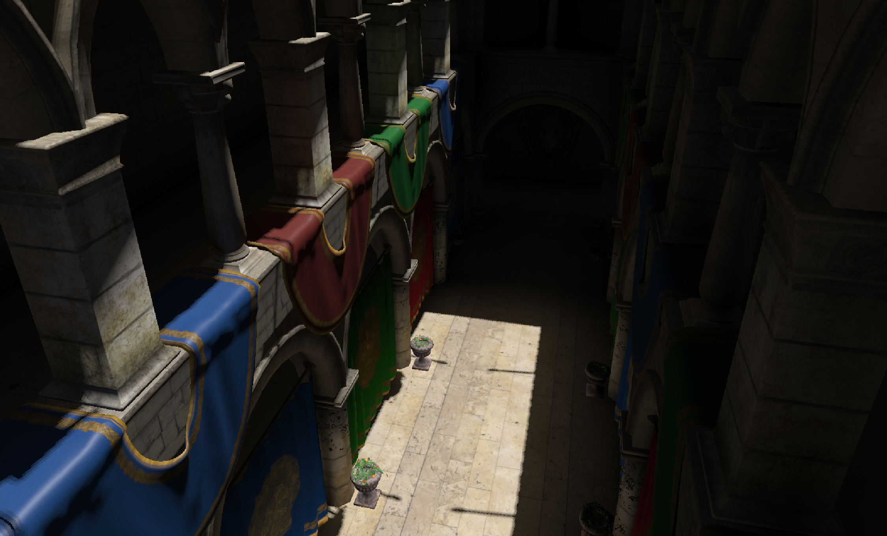
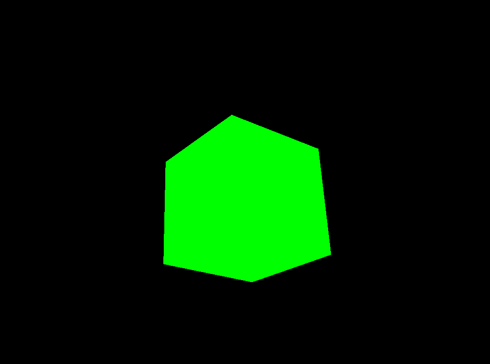
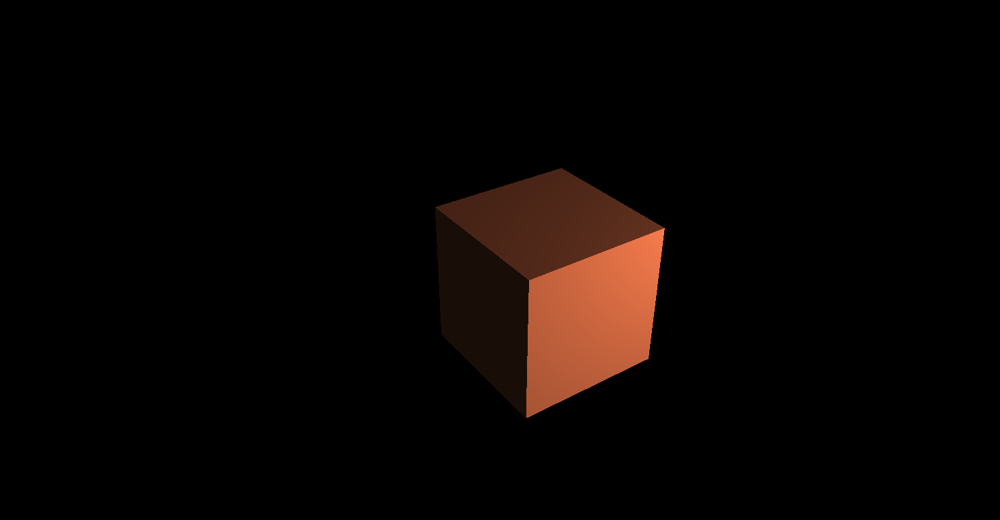
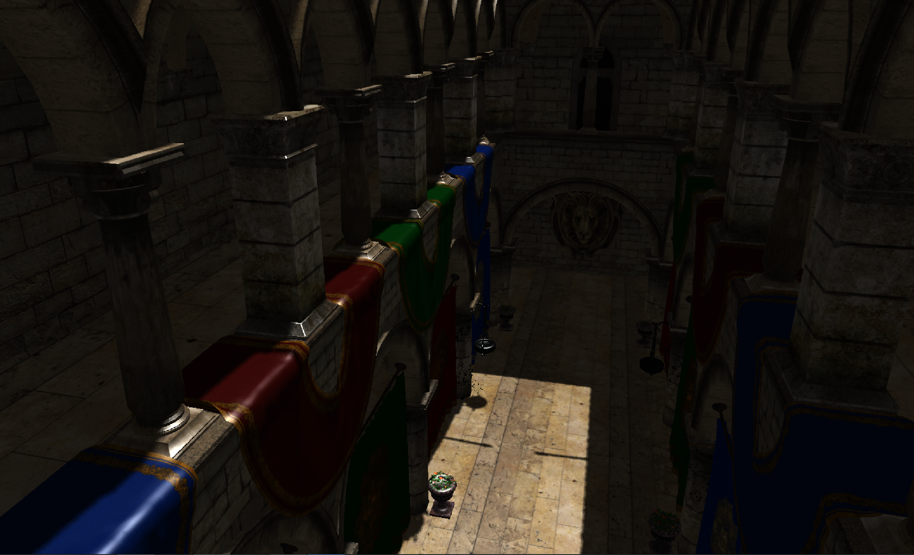
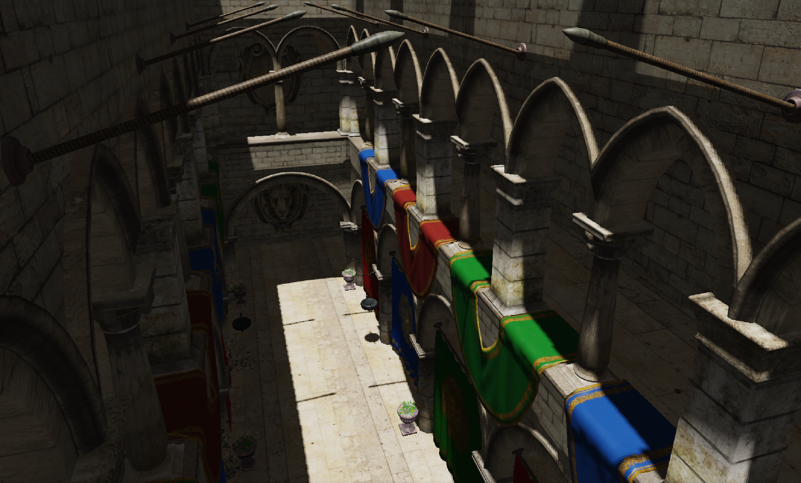
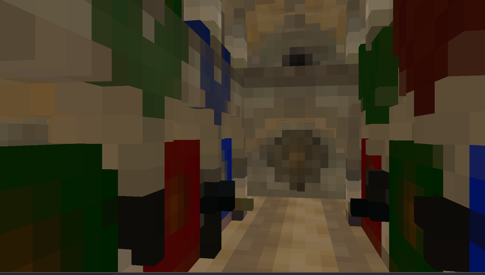
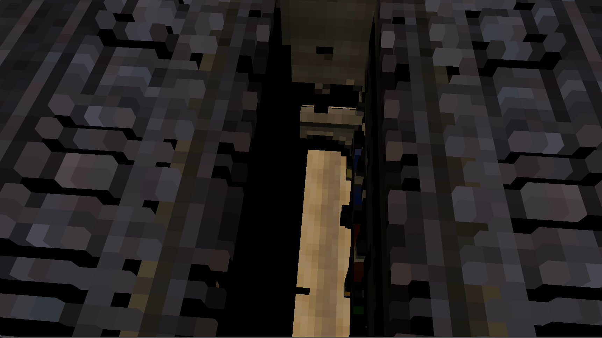

# OpenGL Rendering Experiments

A set of OpenGL 4.x demos in C++20 that go step by step from a single triangle to
**voxel cone traced global illumination** in the Crytek Sponza scene. Each demo
adds one rendering technique on top of the previous one, so reading them in order
follows the path I took to learn real-time rendering.



> **About authorship.** This is a learning project, so it matters which parts I
> wrote and understand and which parts were written by an AI assistant (Claude).
> In short: **I wrote the rendering techniques**: the lighting, shadow, PBR and
> voxel GI shader code and the ideas behind them. **Claude wrote most of the C++
> infrastructure**: the module wrappers around GL objects, the build setup, the
> asset loaders, several helper/debug shaders, and most of the long explanatory
> comments. In addition, LearnOpenGL is an often used resource for this project
> with the Cook-Torrance GGX BRDF functions taken from the repository directly.
> The [Authorship](#authorship) section breaks this down file by file.

---

## Contents

- [Demos](#demos)
- [How each technique works](#how-each-technique-works)
  - [1–2. Pipeline basics and transforms](#12-pipeline-basics-and-transforms)
  - [3. Phong lighting](#3-phong-lighting)
  - [4. Model loading](#4-model-loading)
  - [5. Deferred rendering](#5-deferred-rendering)
  - [6. Shadow mapping](#6-shadow-mapping)
  - [7. Physically based rendering](#7-physically-based-rendering)
  - [8. Voxel cone traced global illumination](#8-voxel-cone-traced-global-illumination)
- [Authorship](#authorship)
- [Project structure](#project-structure)
- [Building and running](#building-and-running)
- [Known issues and next steps](#known-issues-and-next-steps)
- [Credits](#credits)

---

## Demos

| # | Demo | Technique | Screenshot |
|---|------|-----------|------------|
| 1 | `1_hello_triangle` | VAO/VBO/EBO, minimal shaders | none |
| 2 | `2_perspective` | Model/view/projection, fly camera | [perspective.png](src/images/perspective.png) |
| 3 | `3_phong_lighting` | Ambient + diffuse + specular | [phong.png](src/images/phong.png) |
| 4 | `4_model_loading` | OBJ/MTL meshes and textures | none |
| 5 | `5_deferred_rendering` | G-buffer, full-screen lighting pass | none |
| 6 | `6_shadow_mapping` | Directional shadow map + PCF | [shadow_mapping.png](src/images/shadow_mapping.png) |
| 7 | `7_PBR` | Cook-Torrance GGX BRDF, sRGB, tone mapping | [pbr.png](src/images/pbr.png) |
| 8 | `8_voxel_gi` | Voxelization, anisotropic mips, cone tracing | [voxel_gi_final.png](src/images/voxel_gi_final.png) |

**Controls (all 3D demos):** `W`/`A`/`S`/`D` to move, `Space`/`Left Ctrl` to go
up and down, arrow keys to look around. In `8_voxel_gi`, `V` switches between the
lit image and a raw view of the voxel grid.

---

## How each technique works

This section is about the approach and the decisions behind it rather than the
math. The math is standard and comes from the linked references.

### 1–2. Pipeline basics and transforms



The triangle demo covers uploading vertices to a VBO, describing their layout in
a VAO, indexing them with an EBO, and running a vertex and fragment shader over
them. The perspective demo adds model/view/projection matrices and a fly
camera.

<br clear="right">

### 3. Phong lighting



Ambient, diffuse and specular from a single point light. Each face needs its own
normal, so the cube goes from 8 shared vertices to 24, and normals are
transformed by the normal matrix so that non-uniform scale doesn't tilt them.

<br clear="right">

### 4. Model loading

Meshes are loaded from OBJ files through `tinyobjloader`. Each vertex is
`{position, normal, uv}`, and each material provides an albedo color or albedo
texture (plus metallic/roughness/emissive values used later by the PBR demo).

### 5. Deferred rendering

From here on, every demo renders the **Sponza** atrium (about 260k triangles,
dozens of materials).

Deferred rendering stores information into a buffer (G-buffer) to do
lighting calculations in an additional pass. This reduces the number of
lighting calculations needed to be done by not calculating fragments that
are behind the closer fragments/won't be seen.

1. **Geometry pass:** rasterize the scene once and write *surface data* rather
   than colors into several render targets (the **G-buffer**):

   | Attachment | Format | Contents |
   |------------|--------|----------|
   | `gPosition` | RGB16F | world-space position |
   | `gNormal` | RGB16F | world-space normal |
   | `gAlbedo` | RGB8 | base color |
   | `gMetallicRoughness` | RG8 | PBR parameters (demo 7+) |

2. **Lighting pass:** draw one full-screen quad. Each pixel reads its G-buffer
   texels and runs the lighting (Blinn-Phong here) once.

Sponza's foliage and chains use alpha-masked textures. These fragments are
`discard`ed in the geometry pass, because a G-buffer can only hold one surface
per pixel and so cannot do blending.

### 6. Shadow mapping



Shadow mapping follows the LearnOpenGL implementation: render the scene's depth
from the light, then check whether each fragment is the one the light saw at
that point. If it isn't, it's in shadow (the light didn't see that fragment).
The sun is directional, so the light uses an orthographic projection sized to
cover the whole building.

Shadow mapping's usual artifacts, and how each is handled:

- **Shadow acne:** depth precision makes surfaces shadow themselves in stripes.
  Fixed with a constant depth **bias**.
- **Peter-panning:** a large bias detaches shadows from the objects casting
  them. This is reduced by **culling front faces** during the depth pass, so
  the map stores the back faces of closed meshes.
- **Jagged edges:** **percentage-closer filtering (PCF)**, which averages the
  results of a 3×3 grid of shadow tests to soften the edge.

Ambient light is not shadowed, because it approximates indirect light, which
reaches shadowed areas.

### 7. Physically based rendering



Blinn-Phong is replaced with the **Cook-Torrance** BRDF (GGX distribution, Smith
geometry term, Schlick Fresnel) in the metallic-roughness workflow. The BRDF
functions come directly from [LearnOpenGL's PBR chapter](https://learnopengl.com/PBR/Lighting).
Most of the work was in what surrounds the shader:

- **More G-buffer data.** A metallic/roughness target is added, filled from
  per-material texture maps or scalar fallbacks.
- **Linear workflow.** Albedo textures are uploaded as sRGB so the GPU converts
  them to linear when sampling. Lighting happens in linear space and is
  gamma-encoded at the end. Data textures (metallic, roughness) stay linear.
  Without this, the PBR output looked much too dark and contrasty.
- **HDR and tone mapping.** The first version looked washed out, with shadows
  barely visible. PBR diffuse is divided by π, so a sun of intensity 1 was
  barely brighter than the ambient term. The sun is now brighter than 1, ambient
  is lower, and an ACES curve maps the result back into displayable range.

### 8. Voxel cone traced global illumination


This demo replaces the flat ambient term with **one bounce of indirect diffuse
light**, plus **ambient occlusion**. It is based on
[Crassin et al. 2011, *Interactive Indirect Illumination Using Voxel Cone Tracing*](https://research.nvidia.com/publication/2011-09_interactive-indirect-illumination-using-voxel-cone-tracing),
and the voxelization follows
[Crassin & Green, *Octree-Based Sparse Voxelization Using the GPU Hardware Rasterizer*](https://www.icare3d.org/research/OpenGLInsights-SparseVoxelization.pdf)
(OpenGL Insights). It uses a dense 256³ grid instead of the paper's octree (easier implementation at tradeoff
of memory usage)

**The idea:** turn the scene into a 3D grid where each voxel stores how much
light leaves that point. To find the indirect light reaching a pixel, march a
few wide cones out from its surface through the grid, using coarser mip levels
as each cone widens, so a single texture fetch stands in for many rays.

Each frame runs:

```
shadow map ─► voxelize + inject direct light ─► resolve ─► build mips ─► G-buffer ─► lighting with cone tracing
```

#### Voxelizing with the rasterizer

Voxelization reuses the hardware rasterizer. Each triangle is projected along
its **dominant axis** (the axis its normal points most along) onto a 256×256
viewport, so it covers as many pixels as possible and leaves no holes. Each
resulting fragment is one voxel to write.

**First attempt: a layered framebuffer.** The 3D texture was attached to an FBO,
the geometry shader chose the slice with `gl_Layer`, and additive blending summed
overlapping fragments. This doesn't work, for two reasons:

- **An FBO decides the write address itself.** A fragment always lands at
  (raster x, raster y, layer), which maps to the texture's fixed (x, y, z). That
  is only correct for triangles projected down Z. Triangles projected down X or
  Y wrote their colors into permuted, wrong voxels. Forcing every triangle down
  Z fixed the addressing, but then floors and the roof turned into slivers and
  voxelized badly.
- **`gl_Layer` is per triangle**, so a sloped triangle got squashed into a
  single slice.

**The fix** bind an **empty framebuffer** with no attachments, which
only sets the viewport size, and write with **image load/store**. The fragment
shader builds its own `ivec3` voxel coordinate from its raster position, its
depth along the projection axis, and which axis was chosen. The projection is
used only to get good coverage. It no longer determines where the data goes.

**Light injection.** Voxels store *lit* color, not just albedo: the fragment
shader shades each fragment with the sun's diffuse light and tests it against
the shadow map. That way a cone that reaches a voxel picks up light that is
actually bouncing off that surface.

| Albedo stored (debug) | Lit color stored (what cones sample) |
|---|---|
|  |  |

*Mip-0 voxels viewed with the `V` debug view. On the right, only the sunlit
floor strip and the upper walls carry light; everything in shadow is black.*

#### Obstacle: no float atomics on AMD

Many fragments land in the same voxel, so their writes need to be combined
atomically. The natural solution is `imageAtomicAdd` on a float texture, but
float image atomics aren't available on AMD GPUs (it's an NVIDIA extension).

There were two workarounds.

**Compare-and-swap loop (Crassin's approach).** The sparse voxelization chapter
stores each voxel as a packed RGBA8 value in a single 32-bit integer, with the
alpha byte holding the number of fragments averaged so far. To add a fragment,
the shader runs a retry loop:

1. Read the voxel's current packed value.
2. Unpack it and compute the new running average with this fragment included
   (`(avg × count + color) / (count + 1)`), then pack it again.
3. Call `imageAtomicCompSwap(voxel, old, new)`. This writes `new` only if the
   voxel still holds `old`, meaning no other fragment changed it since step 1.
4. If another fragment got there first, the swap fails. Start again from step 1
   with the value that is there now.

This turns any read-modify-write into an atomic operation, so it emulates a
float add without hardware support. The problem is contention: a large flat
surface sends many fragments to the same voxel at the same time. Only one of
them can win each round, so the rest keep looping, and those threads end up
running one after another instead of in parallel.

**Separate integer sums (what I used).** Integer `imageAtomicAdd` *is*
supported everywhere and never retries, so I used **four `r32ui` 3D textures**:
R, G and B are summed as 8-bit fixed-point integers, and the fourth counts the
fragments. Addition doesn't care about order, so every fragment just adds and
moves on. A compute pass then divides by the count and writes a normal
`RGBA16F` volume, because integer textures can't be filtered or mip-mapped for
cone tracing. The cost is precision (8 bits per channel, light clamped to 1
before it's stored), memory (four full-size volumes instead of one), and the
extra resolve pass.

#### Mip levels that don't leak light through walls

Wide cones read coarse mip levels. A normal mip chain averages opacity, so a
one-voxel-thick wall becomes half transparent one level up, then a quarter, and
so on, and cones leak light through walls.

**Obstacle: the GI came out very dark.** The first working version used a
normal mip chain, and the indirect light was far too dim. I tried a hotfix that
raised opacity at coarse mip levels and introducing an ambient color for all
remaining opacity of the cones, but it created unsatisfactory results.

The fix (from the 2011 paper) is **anisotropic voxels**: six coarse volumes, one
for each axis direction. Each is built by combining voxels front to back along
its direction before averaging, so a wall stays opaque when viewed face-on. A
cone samples the three volumes that face its direction and blends them.

#### Cone tracing

For each pixel, six cones cover the hemisphere around the normal: one straight
out along the normal and five tilted around it. I set up their directions in
spherical coordinates around a tangent frame. Each cone steps outward, chooses a
mip level based on how wide it has become, and accumulates color front to back
until it is nearly opaque or leaves the grid.

**Ambient occlusion** comes almost for free: the same cones measure how much is
blocked close to the surface. The final ambient term is the gathered indirect
light darkened by that occlusion.

---

## Authorship

| Area | Files | Written by |
|------|-------|-----------|
| Lighting shaders: Phong, Blinn-Phong, deferred lighting pass | `examples/3–6/*.frag` | **Me** |
| Shadow mapping: light-space reprojection, bias, PCF, front-face culling | `examples/6_shadow_mapping/lighting.frag`, `shadow_map.*` | **Me** |
| PBR (BRDF functions from LearnOpenGL) and G-buffer material layout | `examples/7_PBR/lighting.frag`, `deferred-fragment.frag` | **Me** |
| Voxelization design: dominant-axis projection, empty FBO + image atomics, 4-texture integer accumulation | `examples/8_voxel_gi/voxelize.geom`, `voxelize.frag` | **Me** |
| Direct-light injection into voxels | `examples/8_voxel_gi/voxelize.frag` | **Me** |
| Cone tracing, cone directions/weights, AO, final GI composition | `traceCone` / `traceHemisphere` / `main` in `examples/8_voxel_gi/lighting.frag` | **Me** |
| Demo pass ordering and scene setup | `examples/*/main.cpp` | Claude with edits |
| ACES tone map, roughness clamp, light/ambient intensity tuning | `examples/7_PBR/*` | Claude |
| Anisotropic mip generation | `examples/8_voxel_gi/voxel_mip.comp`, `sampleAniso`/`sampleVoxels` in `lighting.frag` | Claude |
| Voxel resolve pass | `examples/8_voxel_gi/voxel_resolve.comp` | Claude |
| Voxel debug raymarcher (Amanatides & Woo grid traversal) | `examples/8_voxel_gi/voxel_debug.frag` | Claude |
| All engine modules: `Window`, `VertexBuffer`, `Shader`/`ComputeShader`, `Camera`, `Texture`, OBJ/glTF loader, `GBuffer`, `ShadowMap`, `ScreenQuad`, `DirectionalLight`, `VoxelGrid` | `src/*.cppm` | Claude (small edits by me) |
| Build system: CMake + C++20 modules, presets, single-header library setup | `CMakeLists.txt`, `CMakePresets.json`, `src/*_impl.cpp` | Claude |
| Long-form explanatory comments throughout | everywhere | Claude |

I did not write the GL resource-management code (RAII wrappers, move semantics, memory barriers), and I only understand it at a high level.

---

## Project structure

The code uses **C++20 modules** (`.cppm`, `import window;`) instead of headers.
Every demo links the shared `gl_common` library and is built with the
`add_demo(name)` CMake function.

---

## Building and running

**Requirements:** CMake ≥ 3.28, Ninja, Clang with C++20 module support, GLFW 3
installed on the system, and a GPU/driver supporting **OpenGL 4.3** (needed for
compute shaders and image load/store in demo 8). GLM is fetched automatically.

```sh
cmake --preset clang-debug
cmake --build build --target 6_shadow_mapping
./build/6_shadow_mapping
```

For Sponza-based demos, use the release preset. In debug builds, texture
decoding and voxelization are very slow:

```sh
cmake --preset clang-release
cmake --build build/release --target 8_voxel_gi
./build/release/8_voxel_gi
```

**Assets:** Sponza is not checked in . Download the
fixed OBJ version of Sponza with its `textures/` folder and place it at:

- `src/assets/Sponza-master/` for demos 7–8
- `examples/5_deferred_rendering/assets/` and
  `examples/6_shadow_mapping/assets/` for demos 5–6

Shader and asset paths are baked in as absolute paths at configure time, so
executables can be run from any directory.

---

## Known issues and next steps

- **Single bounce, limited precision.** Only one bounce is simulated, light is
  clamped and stored at 8-bit precision during voxelization, and there is no
  sky light.
- **Voxels are rebuilt every frame**, even though the scene is static. Only the
  light injection actually needs to be redone when the light moves.
- **No specular cone.** Only diffuse indirect light is traced. Glossy
  reflections would need one narrow cone along the reflection direction.

Planned techniques: exposure, screen-space reflections, and ray tracing.

---

## Credits

- [LearnOpenGL](https://learnopengl.com/) by Joey de Vries: the main learning
  resource; the PBR BRDF functions come from its PBR chapter.
- Cyril Crassin et al.,
  [*Interactive Indirect Illumination Using Voxel Cone Tracing*](https://research.nvidia.com/publication/2011-09_interactive-indirect-illumination-using-voxel-cone-tracing)
  (2011).
- Cyril Crassin & Simon Green,
  [*Octree-Based Sparse Voxelization Using the GPU Hardware Rasterizer*](https://www.icare3d.org/research/OpenGLInsights-SparseVoxelization.pdf)
  (OpenGL Insights, 2012).
- Amanatides & Woo, *A Fast Voxel Traversal Algorithm for Ray Tracing* (1987),
  used by the voxel debug view.
- Krzysztof Narkowicz's ACES filmic tone-mapping fit.
- **Sponza** model by Frank Meinl (Crytek), with fixes by Morgan McGuire.
- Libraries: [GLFW](https://www.glfw.org/), [glad](https://glad.dav1d.de/),
  [GLM](https://github.com/g-truc/glm), [stb_image](https://github.com/nothings/stb),
  [tinyobjloader](https://github.com/tinyobjloader/tinyobjloader),
  [tinygltf](https://github.com/syoyo/tinygltf).
- Infrastructure and parts of the code written with
  [Claude](https://claude.ai) (Anthropic). See [Authorship](#authorship).
